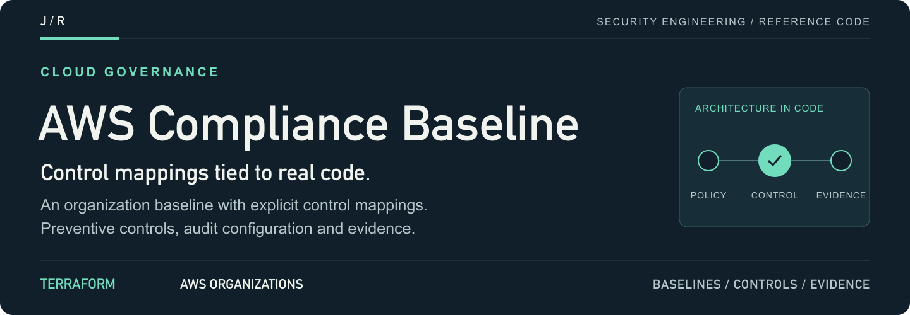
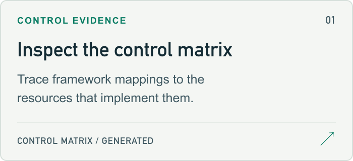
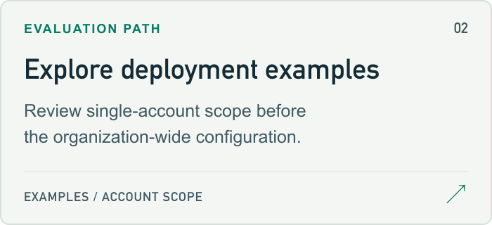
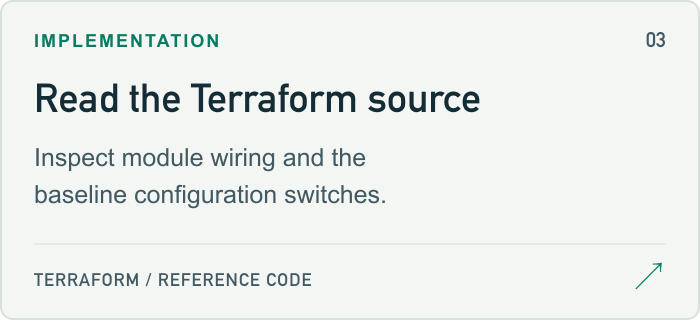
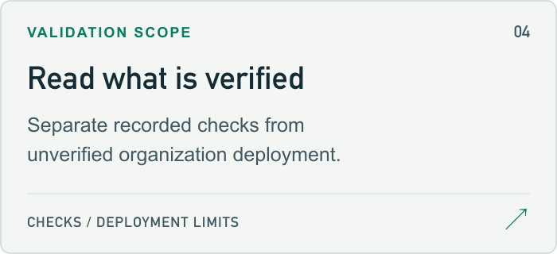
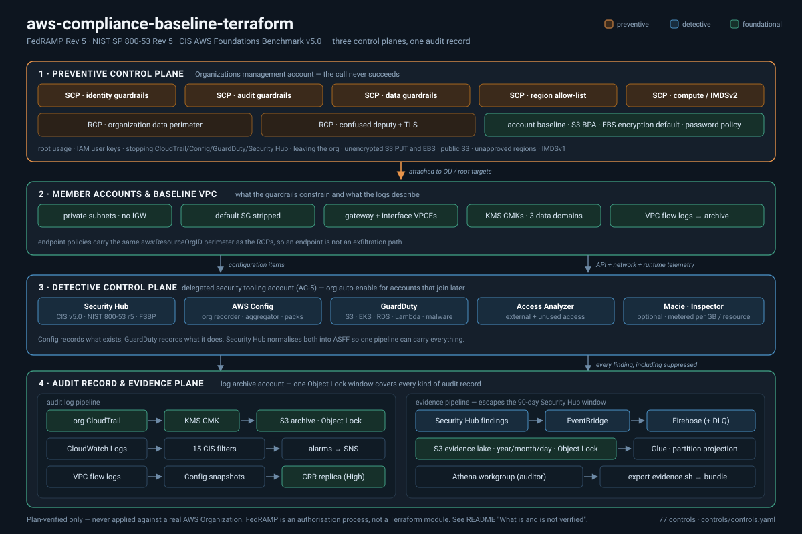

<a id="aws-compliance-baseline-terraform"></a>
<a href="examples/single-account/README.md">
<picture>
  <source media="(max-width: 600px)" srcset="docs/assets/readme/header-mobile.png">
  
</picture>
</a>

<p>
  <a href="examples/single-account/README.md"><strong>Start here ↗</strong></a> &nbsp; / &nbsp;
  <a href="terraform/main.tf">Source</a> &nbsp; / &nbsp;
  <a href="#project-guide">Project guide</a> &nbsp; / &nbsp;
  <a href="https://github.com/jmragsdale">Profile</a>
</p>

An AWS organization reference baseline with Terraform implementations, framework mappings, audit configuration and documented deployment limits.

## Explore the project

Open a card for the implementation, examples or supporting documentation.

<p>
<a href="CONTROLS.md">
<picture>
  <source media="(prefers-color-scheme: dark)" srcset="docs/assets/readme/controls-dark.png">
  
</picture>
</a>
<a href="examples/single-account/README.md">
<picture>
  <source media="(prefers-color-scheme: dark)" srcset="docs/assets/readme/examples-dark.png">
  
</picture>
</a>
<a href="terraform/main.tf">
<picture>
  <source media="(prefers-color-scheme: dark)" srcset="docs/assets/readme/source-dark.png">
  
</picture>
</a>
<a href="#validation-scope">
<picture>
  <source media="(prefers-color-scheme: dark)" srcset="docs/assets/readme/limits-dark.png">
  
</picture>
</a>
</p>

## Project guide

An AWS Organization baseline for FedRAMP Rev 5, NIST SP 800-53 Rev 5 and CIS AWS Foundations v5.0 — where every control claim is verified against the code that implements it.

<details>
<summary>Architecture diagram</summary>



</details>

## 🎯 Overview

Most "compliance baseline" repos have a README table asserting framework coverage and nothing that checks the table is still true. It drifts within a release or two and there is no signal when it does.

This one inverts that. `controls/controls.yaml` is the single source of truth: every control names the Terraform address that implements it, `controls/render.py` generates `CONTROLS.md` from it, and CI fails the build if any claimed address stops existing. A control cannot be claimed without code behind it, and code cannot be deleted while a control still claims it.

**77 controls** across three control planes, each mapped to FedRAMP Rev 5, NIST 800-53 Rev 5 and CIS v5.0 identifiers.

<details>
<summary>Architecture flow (text)</summary>

```
                         ┌──────────────────────────────────────────────────┐
   management account    │  1 · PREVENTIVE          the call never succeeds │
                         │  ────────────────────────────────────────────────│
                         │  5 SCPs   identity · audit · data · region · EC2 │
                         │  2 RCPs   org data perimeter · confused deputy   │
                         │  account  S3 BPA · EBS default enc · pwd policy  │
                         └───────────────────────┬──────────────────────────┘
                                    attached to OU / root targets
                         ┌───────────────────────▼──────────────────────────┐
   member accounts       │  2 · WORKLOAD            private-only VPC, no IGW│
                         │  default SG stripped · VPC endpoints · flow logs │
                         │  KMS CMKs: logs / evidence / general             │
                         └───────┬───────────────────────────┬──────────────┘
                    configuration items              API + network telemetry
                         ┌───────▼───────────────────────────▼──────────────┐
   security tooling      │  3 · DETECTIVE      what Config and GuardDuty see│
   account (AC-5)        │  Security Hub  CIS v5.0 · NIST 800-53 r5 · FSBP  │
                         │  Config org recorder + aggregator + 3 packs      │
                         │  GuardDuty · Access Analyzer · Macie · Inspector │
                         └───────┬───────────────────────────┬──────────────┘
                          audit records                findings (all of them)
                         ┌───────▼───────────────────────────▼──────────────┐
   log archive account   │  4 · AUDIT RECORD & EVIDENCE                     │
                         │  CloudTrail ─► KMS ─► S3 Object Lock COMPLIANCE  │
                         │  CW Logs ─► 15 CIS filters ─► alarms ─► SNS      │
                         │  EventBridge ─► Firehose ─► S3 ─► Glue ─► Athena │
                         │                       └─► CRR replica (High only)│
                         └──────────────────────────────────────────────────┘
```

</details>

## ✨ Features

- 🛡️ **Preventive first.** Five themed SCPs and two RCPs that deny root usage, security-service tampering, unencrypted S3/EBS writes, public S3, unapproved regions, IMDSv1 and leaving the organization. Config tells you a rule was broken; an SCP means the API call returned `AccessDenied`.
- 🔒 **A data perimeter, both halves.** SCPs constrain what *your* principals can do. RCPs constrain what *anyone* — including accounts you have never heard of — can do to *your* resources. Most baselines ship only the first half.
- 📼 **An audit record that cannot be edited.** Object Lock in COMPLIANCE mode, log file validation, versioning, a bucket policy with no exemptions and an SCP protecting the bucket. Remove any one and the control is decorative.
- 🎚️ **`fedramp_baseline` actually changes behaviour.** One lookup table drives retention (365 → 2555 days), key rotation (365 → 90 days), replication (off → on), S3 encryption strictness (any SSE → `aws:kms` only), session ceiling (12h → 1h), password length (14 → 20), AZ floor (2 → 3), flow-log aggregation (600s → 60s) and which conformance pack deploys.
- 🧭 **`deployment_scope` that is honest.** `single_account` gates off every Organizations call so the plan is clean — and `examples/single-account/README.md` states plainly that what remains is a *smaller* posture with almost nothing preventive left.
- 📊 **Evidence beyond 90 days.** Security Hub forgets findings after 90 days; an ATO lasts three years. EventBridge → Firehose → partitioned S3 → Glue → Athena, with saved auditor queries and a DLQ alarm for when the pipeline itself drops a record.
- 🚨 **All fifteen CIS section-4 alarms**, generated from one table so none can quietly go missing, plus an alarm on the audit trail itself falling silent.
- 🧪 **Four OPA policy suites with real unit tests** — encryption invariants, retention floors, data perimeter and SCP structure — including the case generic scanners miss: a wildcard principal with a condition that constrains *network location* rather than identity.
- 💸 **Every metered service behind an `enable_*` flag defaulting to `false`.** A plan against a fresh account costs nothing and surprises nobody.

## 🚀 Quick Start

```bash
git clone https://github.com/<you>/aws-compliance-baseline-terraform
cd aws-compliance-baseline-terraform

# 1. Verify the control matrix is internally consistent before trusting it
python3 controls/render.py --check

# 2. Everything CI runs, locally
./scripts/validate.sh            # --strict fails on checks whose tool is missing
                                 # --json  emits per-check results for tooling

# 3. Pick a shape
cd examples/single-account    # one account, FedRAMP Moderate, no SCPs
#  or
cd examples/org-wide          # organization root, FedRAMP High, everything on

terraform init
terraform plan                # read every deny in the SCP diff before applying
```

Minimal direct use:

```hcl
module "compliance_baseline" {
  source = "./terraform"

  fedramp_baseline = "moderate"
  deployment_scope = "organization"

  organization_id             = "o-yourorgid"
  target_ou_ids               = ["ou-sandbox-first"]   # not the root, not yet
  allowed_regions             = ["us-east-1", "us-west-2"]
  log_archive_account_id      = "111111111111"
  security_tooling_account_id = "222222222222"

  enable_customer_managed_keys = true
  enable_central_logging       = true
  enable_config                = true
  enable_security_hub          = true
  enable_guardduty             = true
}
```

**Before you apply anything at the root:** enable the `SERVICE_CONTROL_POLICY` and `RESOURCE_CONTROL_POLICY` policy types in your organization, enable trusted access for CloudTrail / Config / Security Hub / GuardDuty / Access Analyzer, and attach to a sandbox OU for a full business cycle first. A region allow-list applied at the root on a Friday afternoon is a memorable experience.

## 🔐 Controls

Full matrix: **[CONTROLS.md](CONTROLS.md)** — generated, never hand-edited.

| Framework | Controls implemented | Distinct framework IDs mapped |
|---|---:|---:|
| FedRAMP Rev 5 (Moderate / High) | 77 / 77 | 64 |
| NIST SP 800-53 Rev 5 | 77 / 77 | 54 |
| CIS AWS Foundations Benchmark v5.0 | 36 / 77 | 42 |

| Enforcement | Count |
|---|---:|
| preventive — blocks the non-compliant configuration | 33 |
| detective — reports the non-compliant configuration | 25 |
| foundational — substrate the others depend on | 19 |

Control ID prefixes: `ORG-` organization guardrails · `IAM-` identity · `LOG-` audit logging · `DET-` detective services · `ENC-` keys and encryption · `NET-` network posture · `EVD-` evidence pipeline · `DAT-` data protection.

The integrity check that makes those numbers mean something:

```bash
$ python3 controls/render.py --check
OK: 77 controls, all implementation addresses resolve.
```

<a id="validation-scope"></a>

## ⚠️ What is and is not verified

Read this section before quoting any number above.

**This repo is plan-verified. It has never been applied against a real AWS Organization.**

- ✅ **Verified:** `terraform fmt`, `terraform validate` against every module and both examples, tflint, Checkov (clean, with every accepted finding carrying a written inline `checkov:skip` reason), Trivy, four Conftest/OPA policy suites with unit tests, gitleaks, and the control-matrix integrity check. All of it runs in CI on every push with **no AWS credentials anywhere in the pipeline**.
- ❌ **Not verified:** that any of this applies successfully, that the SCPs deny exactly what they are meant to and nothing else, that CloudTrail delivery actually works with these bucket policies, or that the conformance packs deploy without a CloudFormation error. Those require an organization I do not have, and inventing an apply log would be worse than admitting this.

**What needs an organization you own.** Every control marked `demo_safe: false` in CONTROLS.md — all SCPs and RCPs and their attachments, the organization trail, Security Hub / GuardDuty / Macie / Inspector delegated administration, the Config aggregator, org-scoped Access Analyzer, and cross-region replication. In `single_account` mode these are count-gated off, which leaves a posture with **almost nothing preventive in it**. That gap is real and `examples/single-account/README.md` says so.

**FedRAMP is a process, not a Terraform module.** Nothing in this repository produces an ATO. A FedRAMP authorisation is a System Security Plan, a 3PAO assessment, a POA&M, continuous monitoring deliverables, and an authorising official's signature. This repo implements *technical* controls and produces evidence for them. It cannot touch AT (awareness and training), PS (personnel security), PE (physical protection), or most of PL and PM, and the generated coverage table says so at the top rather than quietly counting them.

**Specific things that are deliberately partial:**

- The conformance packs are **trimmed, hand-maintained subsets** (25 / 35 / 24 rules) of the AWS-published templates, not the full ~150-rule packs. Unreviewed rules generate unreviewed findings. Swap the files in `terraform/modules/detective/templates/` if you want complete published-pack coverage.
- Delegated-administrator resources are declared in a **single provider configuration**. In production the management-account calls and the security-account calls belong in two aliased providers with two roles; that split is left to the caller.
- The Glue table models a **shallow projection of ASFF**, not the full ~200-field schema. The raw `detail` struct is retained so nothing is lost.
- The region allow-list `NotAction` list must be **checked against current AWS documentation** before use. AWS adds global services and the list goes stale.
- The archive bucket policy deliberately **blocks `terraform destroy`** of the archive. Object Lock in COMPLIANCE mode means break-glass is an AWS Support case, not a flag.
- Account IDs, OU IDs and the organization ID in this repo are **obvious placeholders** (`111111111111`, `r-exam`, `o-exampleorgid`). Replace them.

## 💰 Cost

Nothing here is free, and the numbers move by an order of magnitude with account count and API volume. Rough monthly figures for a small organization (5 accounts, low traffic, us-east-1) — treat as a starting point for your own estimate, not a quote:

| Service | Driver | Rough cost | Switch |
|---|---|---|---|
| KMS CMKs | 3 keys ($1 each) + requests | ~$3–8 | `enable_customer_managed_keys` |
| CloudTrail management events | first copy per account is free | ~$0 | `enable_central_logging` |
| CloudTrail **data events** | per million events | **$10–1000+** | `enable_cloudtrail_data_events` |
| AWS Config | per configuration item + per rule evaluation | ~$25–150 | `enable_config` |
| Conformance packs | per rule evaluation, 84 rules across 3 packs | ~$15–60 | `enable_conformance_packs` |
| Security Hub | per check + per ingested finding | ~$15–80 | `enable_security_hub` |
| GuardDuty (base plans) | per GB of events analysed | ~$30–200 | `enable_guardduty` |
| GuardDuty **malware protection** | per GB of EBS scanned | **$50–500+** | `enable_guardduty_malware_protection` |
| Access Analyzer unused access | per IAM role/user analysed | ~$5–40 | `enable_access_analyzer` |
| Macie | per GB inspected | **$50–1000+** | `enable_macie` |
| Inspector | per resource scanned | ~$20–150 | `enable_inspector` |
| Interface VPC endpoints | ~$7 per endpoint per AZ | ~$170 (8 × 3 AZ) | `enable_vpc_endpoints` |
| S3 archive + Firehose + Athena | storage, ingestion, scanned bytes | ~$10–100 | `enable_central_logging`, `enable_evidence_lake` |

Three cost decisions worth calling out:

1. **Everything metered defaults to `false`.** `terraform plan` on a fresh account with defaults costs nothing.
2. **Object Lock in COMPLIANCE mode is a financial commitment.** At `moderate` you pay to store every audit object for 365 days; at `high`, 2555 days. You cannot shorten it, cancel it, or delete your way out of it. Use a short-lived account to evaluate.
3. **Lifecycle tiering is set from the same baseline table** as retention, so Glacier and Deep Archive transitions move with it rather than needing separate tuning.

## 💼 Talking Points

Things in here worth discussing in an interview, and why:

- **The control matrix is falsifiable.** Anyone can write "we cover NIST 800-53". `python3 controls/render.py --check` either exits 0 or names the control whose Terraform address no longer exists. That is a different kind of claim, and building the verification before the content is the point.
- **Five SCPs, not fifteen.** AWS allows five policies per target. A repo with one policy per rule cannot be attached at the root — it fails at apply time, halfway through, leaving the organization half-guarded. Themed bundles plus a `check` block plus an OPA rule asserting the same quota is what respecting a platform limit looks like.
- **Every deny exempts a break-glass role.** An SCP set with no escape hatch has locked out entire organizations, and the recovery path is an AWS Support case and a bad week. The exemption is deliberate, documented, and separately alarmed on.
- **RCPs, not just SCPs.** Ask what stops a principal in an account you have never heard of from reading your bucket via a policy someone added last quarter. SCPs do not answer that question. This is the part of a data perimeter most implementations skip.
- **The `fedramp_baseline` variable is a lookup table, not scattered conditionals.** There is exactly one place to read to answer "what changes at High?", so the parameters cannot drift out of sync with each other.
- **Preventive versus detective is stated per control.** `enforcement: preventive` means the API call fails. `detective` means you find out afterwards. Conflating the two is how a control matrix becomes theatre, and the generated CONTROLS.md splits them 33 / 25 / 19 rather than presenting one number.
- **Evidence has a retention story.** Security Hub keeps 90 days; an ATO runs for three years and continuous monitoring means monthly deliverables. The EventBridge → Firehose → Athena pipeline exists because that arithmetic does not work otherwise — and there is a DLQ alarm because a pipeline that silently drops evidence is worse than no pipeline.
- **The honest-limitations section is the most valuable part of the README.** Anyone who has sat through an assessment can tell the difference between a repo that overclaims and one that does not, in about ninety seconds. Overclaiming is the fastest way to lose that room.
- **Checkov is clean but not silent.** Every accepted finding carries an inline `checkov:skip` with a written reason — why a KMS key policy's `Resource: "*"` means "this key", why the access-log bucket cannot use a CMK, why a VPC endpoint policy is not an IAM policy. A skip list with no reasons is how a compliance repo quietly stops being one.

## 🏷️ Topics

`aws` `terraform` `opentofu` `fedramp` `nist-800-53` `cis-benchmark` `compliance-as-code` `security-baseline` `aws-organizations` `service-control-policies` `resource-control-policies` `scp` `rcp` `guardrails` `cloudtrail` `aws-config` `security-hub` `guardduty` `iam-access-analyzer` `kms` `object-lock` `data-perimeter` `landing-zone` `cspm` `policy-as-code` `opa` `rego` `conftest` `checkov` `audit-logging` `continuous-monitoring` `evidence-collection` `athena` `infrastructure-as-code` `devsecops` `govcloud`

---

If the falsifiable control matrix is an idea you would steal, ⭐ the repo — and if you have applied something like this against a real organization, I would genuinely like to hear which of the caveats above turned out to be the expensive one.

<details>
<summary>README visual assets</summary>

[Artwork sources and regeneration notes](docs/assets/readme/README.md).

</details>
